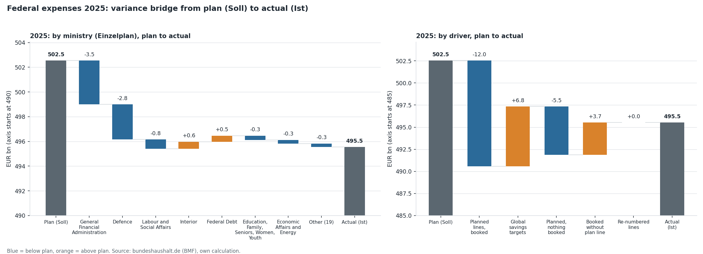
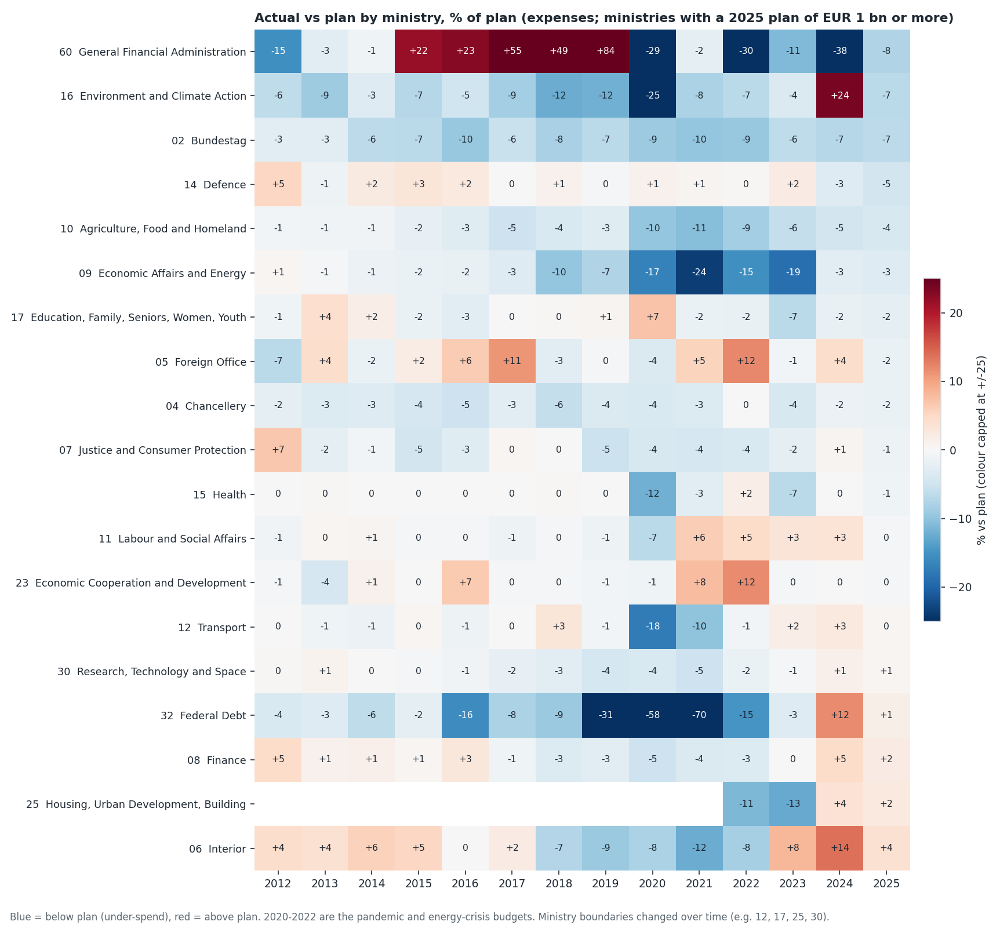
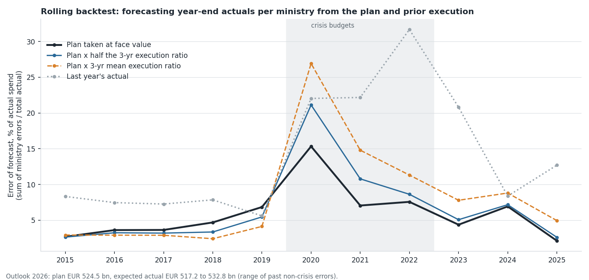

# Budget vs actual: variance analysis of the German federal budget

A finance-controlling case on real public data: where did the German federal government spend differently
from its plan in 2025, what drove it, how well can year-end actuals be forecast from the plan, and can the
numbers be trusted?

**Headline:** the federal government spent **EUR 7.0 bn (1.4 %) less than planned** in 2025
(plan EUR 502.5 bn, actual EUR 495.5 bn). That net figure hides the real picture: lines that were
in the plan were under-spent by **EUR 17.4 bn, 2.5 times the net number**. Global savings
targets that are never booked (EUR 6.8 bn) and spending on lines without a plan entry
(EUR 3.7 bn) offset the rest. 55 lines under-spent by more than 10 % and EUR 50 m,
together EUR 17.5 bn. One level up the signal disappears: only 4 of 26 ministries
were more than 10 % under plan, and they total EUR 0.03 bn.

| Deliverable | File |
|---|---|
| Controller workbook with live formulas, year selector and materiality inputs | [`reports/budget_variance_workbook.xlsx`](reports/budget_variance_workbook.xlsx) |
| Variance bridge (plan to actual, by ministry and by driver) | [`reports/variance_bridge_2025.png`](reports/variance_bridge_2025.png) |
| Actual vs plan by ministry and year | [`reports/execution_heatmap.png`](reports/execution_heatmap.png) |
| Rolling forecast backtest | [`reports/forecast_backtest.png`](reports/forecast_backtest.png) |
| All numbers quoted here | [`reports/results.json`](reports/results.json) |
| SQL (DuckDB): line facts, variance views, drivers, reconciliation checks | [`sql/`](sql/) |



## Data

| | |
|---|---|
| Source | German federal budget, Federal Ministry of Finance: [bundeshaushalt.de](https://www.bundeshaushalt.de) |
| What | Plan (Soll) and actual (Ist, from the budget accounts) for expenses and income, by Einzelplan (ministry), Kapitel (chapter) and Titel (line item), 2012-2025 |
| Access | The public JSON interface behind the site, the same data as its [download portal](https://www.bundeshaushalt.de/DE/Download-Portal/download-portal.html); fetched by [`src/bvc/download.py`](src/bvc/download.py) |
| Licence | The ministry states on the download portal that the data are public and not subject to copyright and may be used, copied, distributed, processed and combined with other data, also commercially. The binding documents are the official budget documents. |
| Downloaded | 2026-11-02 (figures are revised by the source from time to time) |
| Size | 152,772 plan and actual values across the three levels; 4,965 expense lines in 2025 |

The cleaned tables are in `data/processed/` (4 MB). The raw JSON cache (about 90 MB) is not in the repository:
`python -m bvc.download` rebuilds it.

## Results

### 1. The net variance and what is behind it (2025, expenses, EUR bn)

Variance = actual minus plan, so negative means under-spent. Every budget line falls into exactly one bucket, so the
buckets add up to the net variance of −7.0 bn:

| Driver | Lines | Variance |
|---|---:|---:|
| Planned lines, booked | 4,199 | −12.0 |
| Planned, nothing booked | 213 | −5.5 |
| Re-numbered lines (net) | 131 | +0.0 |
| Global savings targets (negative plan) | 26 | +6.8 |
| Booked without a plan line | 396 | +3.7 |

- Planned lines (booked, nothing booked, re-numbered) together are **−17.4 bn**.
- Across all 4,965 lines the gross deviation (sum of absolute variances) is EUR 50.8 bn; the 20 largest lines
  explain 45 % of it.
- The budget data contain no prices or quantities, so a price/volume split is not possible. The driver split above
  (line type) and the category split below are what the data support.

### 2. By ministry and by category (2025)

| Ministry (Einzelplan) | Plan | Actual | Variance | % |
|---|---:|---:|---:|---:|
| General Financial Administration (60) | 46.8 | 43.2 | −3.54 | −7.6 % |
| Defence (14) | 62.3 | 59.5 | −2.85 | −4.6 % |
| Labour and Social Affairs (11) | 190.3 | 189.6 | −0.76 | −0.4 % |
| Education, Family, Seniors, Women, Youth (17) | 14.2 | 13.9 | −0.35 | −2.4 % |
| Finance (08) | 10.6 | 10.8 | +0.22 | +2.1 % |
| Federal Debt (32) | 34.2 | 34.7 | +0.49 | +1.4 % |
| Interior (06) | 15.2 | 15.8 | +0.58 | +3.8 % |

(the 4 largest under-spends and the 3 largest over-spends of 26 ministries; full table in the workbook)

General Financial Administration and Defence explain 91 % of the net variance.
9 of 26 ministries spent more than planned, so ministry totals also net out against each other:
the sum of absolute ministry variances is EUR 10.5 bn against a net EUR 7.0 bn.

| Category (Hauptgruppe) | Plan | Actual | Variance |
|---|---:|---:|---:|
| 4 Personnel | 45.2 | 44.6 | −0.5 |
| 5 Operating costs, military procurement, debt service | 78.2 | 75.8 | −2.3 |
| 6 Grants and transfers (non-investment) | 322.4 | 319.0 | −3.4 |
| 7 Construction | 6.5 | 4.5 | −2.0 |
| 8 Other investment and investment grants | 56.2 | 50.9 | −5.3 |
| 9 Special financing (incl. global savings targets) | -6.0 | 0.6 | +6.6 |

### 3. Largest line-item deviations (2025; official line names, in German)

| Line (Titel) | Ministry | Plan | Actual | Variance |
|---|---|---:|---:|---:|
| Globale Minderausgabe | General Financial Administration | -4.00 | 0.00 | +4.00 |
| Vorsorge Ausgabereste Investitionen | General Financial Administration | 1.70 | 0.00 | −1.70 |
| Tilgungsausgaben aufgrund nicht-struktureller Rückflüsse von notlagenkreditfin | Federal Debt | 0.00 | 1.66 | +1.66 |
| Verwaltungskosten für die Durchführung der Grundsicherung für Arbeitsuchende | Labour and Social Affairs | 5.25 | 6.79 | +1.54 |
| Verstärkung von Personalausgaben der Hgr. 4 | General Financial Administration | 1.43 | 0.00 | −1.43 |
| BAföG - Studierende | Research, Technology and Space | 1.39 | 0.00 | −1.39 |

### 4. History 2012-2025 (expenses, EUR bn)

| Year | Plan | Actual | Variance | % | Sum of absolute ministry variances |
|---|---:|---:|---:|---:|---:|
| 2012 | 311.6 | 307.1 | −4.5 | −1.4 % | 8.9 |
| 2013 | 310.0 | 308.2 | −1.8 | −0.6 % | 4.5 |
| 2014 | 296.5 | 295.9 | −0.6 | −0.2 % | 4.9 |
| 2015 | 306.9 | 311.7 | +4.8 | +1.6 % | 8.3 |
| 2016 | 316.9 | 317.4 | +0.5 | +0.2 % | 11.5 |
| 2017 | 329.1 | 331.0 | +1.9 | +0.6 % | 12.0 |
| 2018 | 343.6 | 348.3 | +4.7 | +1.4 % | 16.3 |
| 2019 | 356.4 | 357.1 | +0.7 | +0.2 % | 24.4 |
| 2020 | 508.5 | 443.4 | −65.1 | −12.8 % | 68.0 |
| 2021 | 572.7 | 557.1 | −15.6 | −2.7 % | 39.3 |
| 2022 | 495.8 | 481.3 | −14.5 | −2.9 % | 36.6 |
| 2023 | 461.2 | 457.7 | −3.5 | −0.8 % | 20.0 |
| 2024 | 476.8 | 474.8 | −2.1 | −0.4 % | 32.9 |
| 2025 | 502.5 | 495.5 | −7.0 | −1.4 % | 10.5 |

- Actual was below plan in 9 of 14 years. Outside 2020-2022 the average net variance is only −0.08 %:
  the total is usually close to plan, so the interesting variance sits underneath it. The sum of absolute ministry variances is a median of
  3.0 times the absolute net variance.
- 2020 is the outlier: EUR 65.1 bn (12.8 %) below a plan that had been raised by supplementary budgets during the pandemic.
- Income side (2025): the budget is balanced by law, so total income equals total expenses in both plan and actual.
  The largest income variance is Federal Debt (−14.4 bn, −17.1 %), the receipts category that carries borrowing, coming in below plan.



### 5. Forecasting year-end actuals

The source has annual figures only, so this is a start-of-year forecast rather than an in-year roll-forward from monthly
execution: for each year, given that year's plan and the execution of earlier years, what will be spent? It is tested with a
rolling origin (11 test years, 2015-2025): each year is forecast with data from earlier years only.
Error = sum of absolute ministry errors / total actual spend.

| Method | Ministry error, all years | Ministry error, excl. 2020-2022 | Total error, all years | Total error, excl. 2020-2022 |
|---|---:|---:|---:|---:|
| Plan at face value | 5.9 % | 4.4 % | 2.4 % | 0.8 % |
| Plan x half the 3-year execution ratio | 6.7 % | 4.1 % | 3.3 % | 1.0 % |
| Plan x 3-year mean execution ratio | 8.2 % | 4.6 % | 4.3 % | 1.6 % |
| Plan x 3-year median ratio | 8.3 % | 4.7 % | 4.8 % | 1.5 % |
| Plan x 5-year mean execution ratio | 8.5 % | 5.4 % | 4.6 % | 1.7 % |
| Last year's actual | 14.0 % | 9.8 % | 8.0 % | 3.9 % |

- **The plan itself is a hard benchmark.** Taken at face value it is off by 5.9 % per ministry (4.4 % without the crisis years)
  and by 0.8 % in total. Adjusting it with past execution ratios helps in calm years only marginally
  (ratio shrunk 3 4.1 % vs 4.4 %) and loses over all years.
  Using last year's actual is clearly worst.
- 2025 backtest: plan error 2.1 % per ministry, +1.4 % in total (forecast minus actual, relative to actual).
- **Outlook 2026:** adopted plan EUR 524.5 bn. With the range of past non-crisis total errors
  (−1.5 % to +1.4 %) the expected actual is EUR 517.2 to 532.8 bn
  (the alternative method gives EUR 521.2 bn). This is a planning range, not a prediction.



### 6. Can the numbers be trusted? Reconciliation checks

Eight checks written as SQL views ([`sql/07_reconciliation.sql`](sql/07_reconciliation.sql)), run over every year, plan and actual, expenses and income.
**8 of 8 pass on the official data** (no violations): totals tie from line item to chapter to ministry to
total; line items per category tie to the source's own category totals (an independent aggregation); total expenses equal total income;
no missing parents or malformed codes; no duplicates; category codes valid; no unexplained negative expense line above EUR 1 bn;
full year coverage. Negative expense lines do exist (bond discounts, refunded Covid aid, global savings targets); they stay below
2.7 % of actual spending in any year and are covered by a documented allow-list.
The tests also tamper with a copy of the data and require each check to catch it, so a passing check means something.

## Method

| Step | File |
|---|---|
| Download plan and actual, all levels, with retries and an on-disk cache | [`src/bvc/download.py`](src/bvc/download.py) |
| Load into DuckDB, build facts and views | [`src/bvc/data.py`](src/bvc/data.py), [`sql/`](sql/) |
| Variance, decomposition, bridge (pure pandas) | [`src/bvc/calc.py`](src/bvc/calc.py) |
| Rolling-origin forecast and backtest | [`src/bvc/forecast.py`](src/bvc/forecast.py) |
| Reconciliation checks | [`sql/07_reconciliation.sql`](sql/07_reconciliation.sql), [`src/bvc/checks.py`](src/bvc/checks.py) |
| Analysis, charts, workbook, this README | [`src/bvc/analysis.py`](src/bvc/analysis.py), [`charts.py`](src/bvc/charts.py), [`excel.py`](src/bvc/excel.py), [`readme.py`](src/bvc/readme.py) |
| Rebuild everything | `python -m bvc.build` |
| Tests: checks pass on the real data and fail on tampered data, variance identities, the bridge closes, the forecast does not look ahead, the workbook recalculates to the same numbers, README figures equal `results.json` | [`tests/`](tests/) |

Choices worth defending:

- **Planned and unplanned are separated.** In the plan, negative lines (global savings targets) are (almost) never booked, so they appear
  as an over-spend of the same size and hide real under-spends. Splitting them out is what turns EUR 7.0 bn into EUR 17.4 bn.
- **Materiality needs two limits.** More than 10 % alone flags tiny budgets (Federal President, Federal Council); more than an amount alone
  flags large budgets that are on plan. Both limits are inputs in the workbook.
- **Re-numbered lines are matched** on ministry and identical title text within a year, so a line that moved to another number
  is not counted as one under-spend plus one unplanned spend.
- **The checks use two independent routes** (sum of children, and the source's own category totals) rather than one.
- **The forecast is compared with the plan, not with nothing.** An adjusted forecast is only worth having if it beats the budget as written.

## Limits

- **Annual data only.** No monthly or quarterly execution, so there is no in-year roll-forward; the forecast is made at the start of the year.
  Monthly cash reports of the Ministry of Finance would be the next data source.
- **The plan is the published plan including supplementary budgets**, not adjusted for carried-over funds (Haushaltsreste, Ausgabereste).
  Spending of carried-over funds shows up under "booked without a plan line".
- **No price/volume decomposition**: budget lines carry no quantities or prices.
- **Ministry boundaries move** (for example 2021/22 and 2025 reorganisations). Series are compared by Einzelplan number and show the
  latest name, so a few ministry-level year-on-year comparisons are not like for like.
- **Technical items are not controllable spend.** General Financial Administration and Federal Debt contain reserves, savings targets and debt
  service; a controller would often analyse them separately.
- **Ministries over EUR 1 bn:** the 1 bn cut-off for "large" is a choice; with 0 large ministries under-spending by more than 10 %, the conclusion does not depend on it.
- **Small backtest:** 11 test years, 3 of them crisis years. The difference between the best adjusted method and the plan in calm years is small and not statistically meaningful.
- The negative-line allow-list was written after looking at the data.
- Line matching for re-numbered items uses exact text and will miss renamed lines.

## Run it

```bash
python3 -m venv .venv && source .venv/bin/activate
pip install -r requirements.txt && pip install -e .
python -m bvc.download     # optional: re-download (about 12,000 requests, cached in data/raw/cache)
python -m bvc.build        # results.json, workbook, charts, this README, from data/processed
python -m pytest -q
```

Every number above comes from `reports/results.json`, produced by `python -m bvc.build`, and a test fails if this README and the code disagree.
